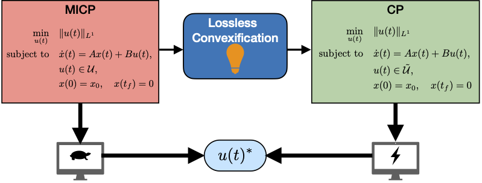

# Geometric Conditions for Lossless Convexification in Linear Optimal Control with Discrete-Valued Inputs

 **Felipe Arenas-Uribe, Hasan A. Poonawala, and Jesse B. Hoagg**, 

 Autonomy, Robotics and Controls Lab, 


 University of Kentucky.

<p align="center">
  
</p>

The paper studies fuel-optimal control of linear time-varying systems with discrete actuator inputs. Under its geometric and system-normality conditions, an optimal control of the continuous convex relaxation takes values in the original discrete input set almost everywhere. The numerical example uses Yamanaka–Ankersen relative motion in an elliptical orbit.

## Code and experiments

- [Paper_Experiments.ipynb](Paper_Experiments.ipynb): runs the paper's horizon selection, convex and mixed-integer validation, grid-resolution sweep, and fixed-horizon Monte Carlo study.


## Setup and run

Use Python 3.10 or newer. From this directory:

```bash
python -m venv .venv
source .venv/bin/activate
python -m pip install -r requirements.txt
jupyter lab
```

Open `Paper_Experiments.ipynb` and run all cells in order. In VS Code, select the installed environment as the notebook kernel. The default run performs all convex experiments and loads the recorded mixed-integer solution. In the first code cell, set `RUN_MILP=True` to solve the mixed-integer problem afresh; this requires Gurobi and an appropriate license and can take several minutes.


## Citation

See the [paper preprint](https://arxiv.org/abs/2511.07711). If you find this work useful, please consider citing us:

```bibtex
@misc{arenasuribe2026geometricconditionslosslessconvexification,
  title={Geometric Conditions for Lossless Convexification in Linear Optimal Control with Discrete-Valued Inputs: Real-Time Implementation for Spacecraft Rendezvous},
  author={Felipe Arenas-Uribe and Hasan A. Poonawala and Jesse B. Hoagg},
  year={2026},
  eprint={2511.07711},
  archivePrefix={arXiv},
  primaryClass={math.OC},
  url={https://arxiv.org/abs/2511.07711}
}
```
